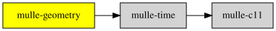

# mulle-geometry

#### 🔭 Basic geometric types


# 🔭 mulle-geometry

#### 🔭 Basic geometric types

This library contains definitions and functions for (macOS/iOS) familiar
data types like **CGRect** and custom data types like **CACircle** or
**CAPolarPoint**. `CG` prefixed datatypes are legacy names, which may already
be familiar to you. Documentation for these data types already exists outside
of the project.

For a nice overview read [NSHipster:Core Graphics Geometry Primitives](https://nshipster.com/cggeometry/).

CA prefixed data types are custom and not documented elsewhere.


| Data type           | Description
|---------------------|---------------------------
| `CGFloat`           | legacy name of `float` in CoreGraphics
| `CGPoint`           | cartesian point
| `CGRect`            | rectangle
| `CGSize`            | size
| `CGVector`          | cartesian vector (rarely used)


| Data type           | Description
|---------------------|---------------------------
| `CAAngle`           | a datatype for angles
| `CACircle`          | a representation of a center point with a radius
| `CAPolarPoint`      | point as an angle and distance from 0,0
| `CAQuadratic`       | interpolation value
| `CAQuadraticBezier` | bezier curve
| `CARotation`        | the rotation of something (0: none, 0.25: 90° right)


### CAAngle

Instead of using `float` radians, use `CAAngle`. Angles are always normalized
and therefore comparable. Though internally represented as *radians*, you
should use `CAAngleToRadians` and `CARadiansToAngle` to convert back and
forth.


### CACircle

Having a separate `CACircle` is useful for layout purposes.


### CAPolarPoint

Polar points are invaluable for animations of circular motions.


| Release Version                                       | Release Notes
|-------------------------------------------------------|--------------
|  [](//github.com/mulle-gfx/mulle-geometry/actions) | [RELEASENOTES](RELEASENOTES.md) |


### You are here




## Add

**This project is a component of the [mulle-core](//github.com/mulle-core/mulle-core) library. As such you usually will *not* add or install it
individually, unless you specifically do not want to link against
`mulle-core`.**


### Add as an individual component

Use [mulle-sde](//github.com/mulle-sde) to add mulle-geometry to your project:

``` sh
mulle-sde add github:mulle-gfx/mulle-geometry
```

To only add the sources of mulle-geometry with dependency
sources use [clib](https://github.com/clibs/clib):


``` sh
clib install --out src/mulle-gfx mulle-gfx/mulle-geometry
```

Add `-isystem src/mulle-gfx` to your `CFLAGS` and compile all the sources that were downloaded with your project.


## Install

### Install with mulle-sde

Use [mulle-sde](//github.com/mulle-sde) to build and install mulle-geometry and all dependencies:

``` sh
mulle-sde install --prefix /usr/local \
   https://github.com/mulle-gfx/mulle-geometry/archive/latest.tar.gz
```

### Manual Installation

Install the requirements:

| Requirements                                 | Description
|----------------------------------------------|-----------------------
| [mulle-core](https://github.com/mulle-core/mulle-core)             | 🌋 Almagamated library of mulle-core and mulle-c

Install **mulle-geometry** into `/usr/local` with [cmake](https://cmake.org):

``` sh
cmake -B build \
      -DCMAKE_INSTALL_PREFIX=/usr/local \
      -DCMAKE_PREFIX_PATH=/usr/local \
      -DCMAKE_BUILD_TYPE=Release &&
cmake --build build --config Release &&
cmake --install build --config Release
```


## Author

[Nat!](https://mulle-kybernetik.com/weblog) for Mulle kybernetiK  


